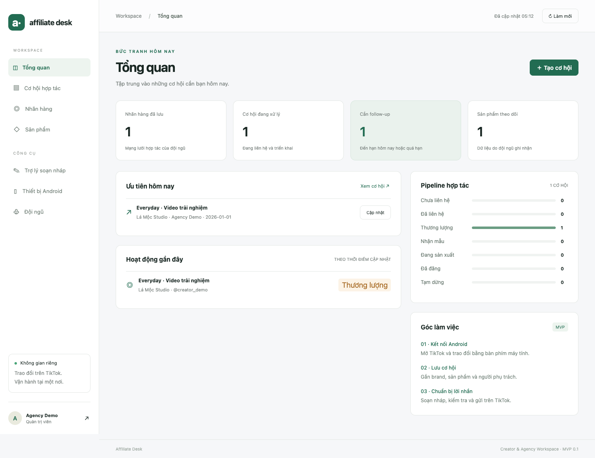

# TikPhone CRM — Affiliate Desk MVP 0.1.1

Ứng dụng vận hành nội bộ dành cho một agency/đội creator: nhãn hàng, sản phẩm, cơ hội hợp tác, follow-up, bản nháp và kết nối Android thật. Giao diện tiếng Việt.


**Bắt đầu:** [Hướng dẫn nhanh](docs/QUICKSTART.md) · [Kiến trúc](docs/ARCHITECTURE.md) · [Kiểm thử](docs/TEST-REPORT.md) · [Phát hành](docs/RELEASING.md)



## Mở ứng dụng

- **Mac Apple Silicon (M1/M2/M3/M4…):** giải nén bản Mac và mở `Affiliate Desk.app`.
- **Windows x64:** giải nén toàn bộ bản Windows vào một thư mục rồi mở `Affiliate Desk.exe`. Giữ nguyên các file và thư mục đi kèm.
- Bản desktop được đóng gói cùng backend, Python runtime và ADB/scrcpy. Không cần Node.js hoặc Python cài riêng để dùng bản đóng gói.
- Bản phát triển chưa có chứng chỉ ký phát hành/notarization. Mac có thể yêu cầu xác nhận mở ứng dụng trong Privacy & Security. Bản Windows cần kiểm thử trên thiết bị Windows trước khi dùng chính thức.

Lần đầu trên bản desktop local, mã thiết lập được điền sẵn. Nhập tên, email và mật khẩu từ 12 ký tự để tạo workspace. Khi dùng server chung hoặc chạy source, dùng mã thiết lập in trong terminal của server. Email là tên đăng nhập nội bộ, không gửi email xác nhận. Không nhập mật khẩu TikTok vào CRM.

Sau khi đăng nhập:

1. Vào **Nhãn hàng** để thêm brand và người phụ trách.
2. Vào **Sản phẩm** để lưu link, giá, hoa hồng, nguồn và ngày ghi nhận.
3. Tạo **Cơ hội hợp tác**, gắn brand/sản phẩm/creator, chọn trạng thái và ngày follow-up.
4. Dùng **Trợ lý soạn nháp** để tạo mẫu, chỉnh sửa, sao chép hoặc lưu lại.
5. Mở **Thiết bị Android** để điều khiển điện thoại trong cửa sổ riêng.
6. Quản trị viên thêm tài khoản tại **Đội ngũ**. Mỗi người có thể đổi mật khẩu của mình tại đây.

Workspace khởi tạo rỗng. Ảnh `docs/assets/preview.png` dùng dữ liệu kiểm thử minh hoạ, không phải dữ liệu TikTok thật.

## Kết nối Android

Bản desktop đã có ADB và scrcpy 5.0.1. Trên điện thoại:

1. Bật Developer options và USB debugging.
2. Cắm cáp có truyền dữ liệu, mở khoá điện thoại và chấp nhận máy tính được debug.
3. Trong app, mở **Thiết bị Android → Kiểm tra kết nối → Mở điều khiển**.
4. Mở TikTok trên màn hình Android, đăng nhập và chọn mục tin nhắn với brand.
5. Soạn nội dung trong app, sao chép rồi dán vào đúng cuộc trò chuyện trên TikTok.

Nếu thiết bị hiển thị `unauthorized`, cần xác nhận trên điện thoại. Nếu Windows không nhận USB, kiểm tra driver của nhà sản xuất. Nhập tiếng Việt, clipboard, gửi ảnh và độ ổn định của hộp thư cần kiểm thử bằng điện thoại/tài khoản thực tế.

scrcpy hiển thị và điều khiển điện thoại; nó không cung cấp cơ sở dữ liệu tin nhắn TikTok cho CRM. MVP chưa có inbox đồng bộ, tự đọc tin mới hay tự gửi tin. Đăng nhập TikTok nằm trên điện thoại.

## CRM dùng chung cho đội ngũ

Mặc định app dùng database trên máy đang mở. Hai bản app ở chế độ mặc định là **hai workspace riêng**, chưa đồng bộ với nhau.

Để làm việc chung, chạy **một server CRM trung tâm**, rồi cấu hình tất cả app trỏ về server đó. Server trung tâm giữ database; mỗi app desktop vẫn kết nối Android tại chính máy nhân sự.

Trên máy chủ có Python 3.9+ (ưu tiên một bản Python còn được hỗ trợ), chạy từ thư mục mã nguồn:

```sh
AFFILIATE_PUBLIC_HOST=crm.ten-mien-cua-ban.vn python3 app/server.py --port 8765 --data /duong-dan-rieng/workspace.sqlite3
```

Lệnh trên dùng cú pháp môi trường Linux/macOS. `AFFILIATE_PUBLIC_HOST` là tên miền của reverse proxy, không kèm `https://`. Backend vẫn lắng nghe ở loopback. Không bật `--devices` trên server chung. Đặt server sau HTTPS reverse proxy và giới hạn truy cập cho đội ngũ. Có cấu hình Caddy mẫu trong `deploy/Caddyfile.example`. Backend dùng thư viện HTTP của Python, phù hợp pilot nội bộ; trước khi mở dịch vụ công khai cần chuyển sang server ứng dụng production, triển khai giám sát và kiểm thử tải.

Trên từng app desktop:

1. Mở menu **Affiliate Desk → Mở cấu hình server CRM**.
2. Sửa `config.json`:

```json
{
  "server_url": "https://crm.ten-mien-cua-ban.vn"
}
```

3. Thoát và mở lại app. Tất cả nhân sự dùng cùng địa chỉ, đăng nhập bằng tài khoản quản trị viên đã tạo.

Để quay về local, đặt `server_url` thành chuỗi rỗng. Việc đổi địa chỉ **không tự chuyển dữ liệu local lên server**. Khi muốn chuyển workspace đã có dữ liệu, tạo backup theo hướng dẫn dưới, dừng backend đích và dùng bản backup làm database của server mới.

MVP có hai quyền:

| Quyền | Khả năng |
| --- | --- |
| Admin | Thêm nhân sự, xem nhật ký, quản lý toàn bộ CRM |
| Member | Xem và sửa CRM chung, soạn/lưu bản nháp, kết nối Android tại máy mình |

Phân công brand/cơ hội là phân công công việc, không phải giới hạn quyền xem theo người. Bản này chưa có nhiều agency tách biệt trong cùng database, chưa có phân quyền theo từng brand, thu hồi tài khoản qua UI hoặc khôi phục mật khẩu qua email. Có chống ghi đè khi hai người sửa cùng một bản ghi: người lưu sau nhận thông báo tải lại.

## Bật AI soạn nháp

Mẫu tin nhắn hoạt động ngay và được đánh dấu **Mẫu có sẵn**. Nút AI chỉ bật khi **backend đang dùng** có cả `OPENAI_API_KEY` và `OPENAI_MODEL`.

Cấu hình hai biến này trong môi trường chạy server hoặc kho secret của máy chủ. Không đặt API key vào mã frontend, database CRM hay `config.json`. `OPENAI_MODEL` phải là model hỗ trợ Responses API mà tài khoản của bạn được phép gọi. App không gán một model trả phí mặc định.

Backend gọi `POST https://api.openai.com/v1/responses`, với `store: false`. Khi bấm AI, tên brand, dữ liệu sản phẩm được chọn, tên đại diện và brief được gửi tới OpenAI. Giao diện thông báo việc này ngay dưới ô brief. Không gửi mật khẩu TikTok hoặc toàn bộ CRM. Nội dung chỉ tạo bản nháp; người dùng vẫn kiểm tra và gửi thủ công.

Chưa chạy kiểm thử AI thật vì phiên triển khai chưa có API key/model được cấu hình. Đã kiểm thử luồng thành công giả lập và trường hợp chưa cấu hình. Tham khảo [OpenAI: Text generation](https://developers.openai.com/api/docs/guides/text).

## Dữ liệu và sao lưu

- Desktop local: database `workspace.sqlite3` trong thư mục user data của Electron. Mở menu cấu hình để tìm thư mục chứa `config.json` và database.
- Chạy từ mã nguồn không chỉ định `--data`: `data/workspace.sqlite3` trong project.
- Server chung: vị trí được truyền bằng `--data`.
- Dữ liệu nằm trên máy chủ/local; chưa có dịch vụ cloud nào được tạo hoặc mua.

Sao lưu nhất quán ngay cả khi server đang chạy:

```sh
python3 scripts/backup.py /duong-dan/workspace.sqlite3 /duong-dan-backup/workspace-2026-10-26.sqlite3
```

Lưu backup ở nơi đội ngũ kiểm soát. Khi khôi phục, dừng server, giữ lại database cũ và các file WAL/SHM cùng bộ để có thể quay lại, rồi khởi động server với **đường dẫn mới** trỏ tới file backup. Không chép đè database đang mở.

## Chạy từ mã nguồn

Bản browser local không cần thư viện Python bên ngoài:

```sh
python3 app/server.py --devices
```

Mở [http://127.0.0.1:8765](http://127.0.0.1:8765). `Start.command` và `Start.bat` làm cùng việc này. Để kết nối điện thoại khi chạy source, cài ADB/scrcpy vào PATH hoặc dùng `ADB_PATH`, `SCRCPY_PATH`; bản desktop đóng gói đã cung cấp các công cụ này.

Chạy Electron development (Node.js 22+, Python 3.9+):

```sh
npm ci
npm start
```

Các biến cấu hình:

| Biến | Ý nghĩa |
| --- | --- |
| `AFFILIATE_PUBLIC_HOST` | Tên miền được chấp nhận khi server chung nằm sau HTTPS reverse proxy |
| `AFFILIATE_SERVER_URL` | Địa chỉ CRM chung; ưu tiên hơn `config.json` |
| `AFFILIATE_USER_DATA` | Thư mục user data riêng, hữu ích cho kiểm thử |
| `AFFILIATE_PYTHON` | Python thực thi trong development; bản Mac đóng gói dùng backend riêng |
| `ADB_PATH`, `SCRCPY_PATH` | Ghi đè đường dẫn công cụ kết nối |
| `OPENAI_API_KEY`, `OPENAI_MODEL` | Cấu hình AI phía backend |

## Build lại

```sh
npm ci
python3 scripts/prepare_runtime.py
python3 -m venv .build-env
.build-env/bin/pip install -r requirements-build.txt
.build-env/bin/python scripts/build_backend.py
npm run build:mac
npm run build:win
```

Bước build backend chạy trên Mac Apple Silicon. Windows zip được đóng gói từ runtime Python Windows x64 chính thức; không cần build Python trên Windows. Các runtime tải về nằm trong `runtime/`, không lưu trong source archive. `prepare_runtime.py` kiểm checksum scrcpy với file checksum do dự án phát hành. Mac Intel/Windows ARM chưa có gói riêng trong bản bàn giao này.

## Kiểm thử

```sh
python3 -m unittest discover -s tests -v
npm run check
npm run test:ui
node tests/desktop-smoke.cjs
```

Kiểm thử UI cần Google Chrome cài sẵn, hoặc đặt `CHROME_PATH` tới Chrome thực thi. Desktop smoke chạy bản Mac đã build; có thể ghi đè đường dẫn bằng `DESKTOP_APP`. Tests dùng database tạm, không đụng tới workspace của người dùng.

Kết quả và giới hạn xác minh cuối cùng nằm trong [docs/TEST-REPORT.md](docs/TEST-REPORT.md).

## Mở rộng tiếp

Code được chia thành `app/server.py` (API, lưu trữ, xác thực, AI, thiết bị), `app/app.js` (UI), `desktop/` (Electron, IPC) và `tests/`. SQLite giữ dữ liệu trên một server; UI gọi HTTP API, nên có thể thay lớp lưu trữ bằng PostgreSQL ở giai đoạn tiếp theo mà không đổi mô hình sử dụng.

Các bước tiếp theo đã để ngoài MVP: tích hợp quyền API TikTok thực tế, đồng bộ hộp thư, product radar có nguồn dữ liệu, workflow automation, thu hồi tài khoản và phân quyền chi tiết. Kho sản phẩm hiện là dữ liệu nhập thủ công, không được trình bày như dữ liệu toàn sàn.
